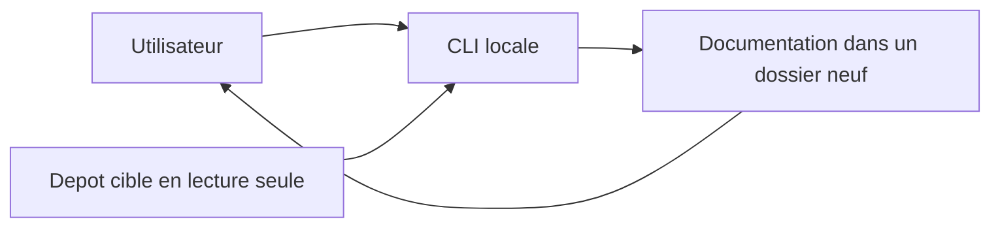
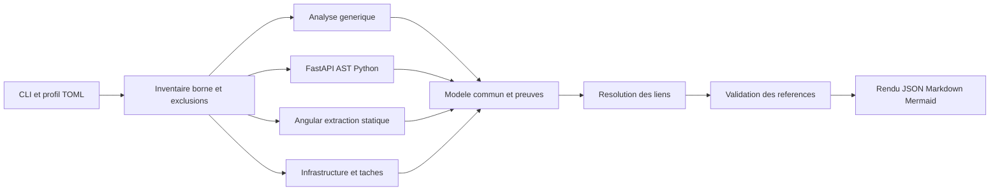
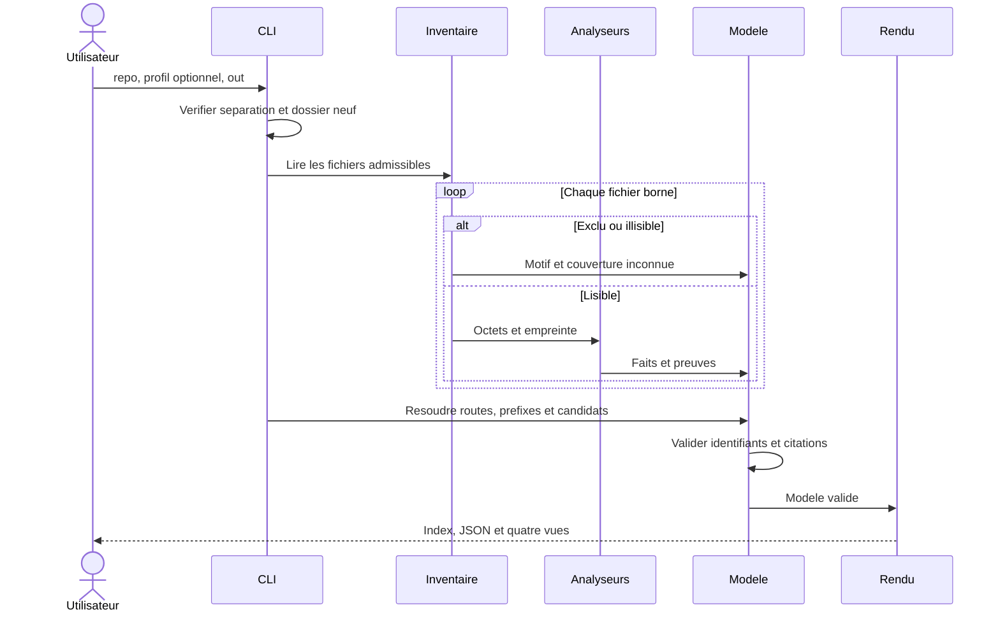

# Architecture de retro_doc_lab

## Contexte et frontières

Le lab est un outil local d'analyse statique. Le dépôt cible est une donnée non
fiable : aucun import, test, script, hook, instruction locale ou commande de ce
dépôt n'est exécuté. Aucun accès réseau n'est nécessaire. Les exclusions sont
appliquées avant ouverture; les valeurs sensibles détectées dans les fichiers
admis entraînent leur mise à l'écart, sans copie de contenu dans les rapports.
Les sources restent en lecture seule et la sortie doit être extérieure au dépôt.

## Composants

L'implémentation existante dans `src/retro_doc_agent` est conservée. Le pipeline
historique, son dashboard et ses comparaisons restent accessibles. La commande
`retro_doc_lab scan` est un adaptateur vers le nouveau moteur de cartographie.

L'inventaire possède les octets et empreintes des fichiers admis. Les analyseurs
interprètent ces octets sans accéder directement au système de fichiers. Le modèle
porte identifiants déterministes, preuves relatives et statuts `observé`, `inféré`,
`non résolu`. Le résolveur conserve les candidats ambigus. Le rendu ne relit jamais
le dépôt. Les identifiants reposent sur le type, le chemin et le symbole; les
positions sans symbole peuvent changer après une édition.

## Flux d'exécution

Un framework inconnu conserve son inventaire et ses composants fichiers. Un
parsing impossible est inscrit dans les limitations. Une route dynamique, un
proxy non résolu ou des candidats multiples ne deviennent pas une correspondance
certaine. Une séquence est une reconstruction statique, jamais une trace exécutée.

Le pipeline local historique est désormais découpé en quatre phases sélectionnables
dans `src/retro_doc_agent` : `analyzer.py` caractérise l'inventaire admis,
`audit.py` orchestre l'audit statique, `sequences.py` génère des séquences Mermaid
bornées depuis les appels locaux résolus de façon unique, et `reporter.py` assemble
`audit_report.md`. Les prérequis sont automatiques (`audit` inclut l'analyseur;
`sequences` inclut l'analyseur et l'audit; `reporter` inclut toutes les phases).
`--verbose` journalise les phases et leurs compteurs. Les appels restent inférés,
les séquences sont limitées à 20 routes et ne sont pas des traces runtime.

## Contrat d'extension

Un analyseur reçoit `(model, path, text)` et ajoute des éléments via `model.add`
avec `kind`, `key`, `label`, `evidence` et `status`. Chaque preuve contient `path`,
`start_line`, `end_line`, `sha256`. Il ne doit ni ouvrir d'autres fichiers ni
exécuter du code. Les relations référencent uniquement des identifiants existants.
Les flux, états et transitions ont leurs propres identifiants et preuves.

Pour intégrer un framework : définir les constructions reconnues, ajouter un
analyseur dans `analyzers`, l'enregistrer dans le scanner, fournir des fixtures
synthétiques positives, ambiguës et négatives, puis documenter ses limites.
Les heuristiques doivent rester `inféré` et conserver les indices rapprochés.

## Portée de la première version

Python 3.11+ pour TOML standard. FastAPI est lu par AST; TypeScript, Compose et
Caddy utilisent une extraction volontairement limitée, sans compilateur installé
depuis le dépôt. Les expressions dynamiques, injections, imports indirects,
conditions de montage et configurations multi-environnements restent à examiner.
Les états détectés ne prouvent pas une machine exhaustive. Aucun pourcentage de
documentation complète n'est déduit des fichiers générés. La validation Mermaid
par parseur local est distincte des contrôles de structure; son absence est signalée.

Les livrables déterministes du nouveau scan n'incluent pas d'horodatage. Le contrat
historique v1 demeure celui du pipeline `run`; `scan` produit un modèle v2 et un
manifeste déterministe avec révision et état Git non établis (aucune commande dans
le dépôt cible). Une comparaison des empreintes avant/après vérifie les fichiers
admissibles seulement; les fichiers exclus ne sont jamais lus pour ce contrôle.
